# Bumle Business – VPN-logovervågning

## Cybersikkerhed 1. semester - Projekt i programmering og projektledelse

---

## 1. Introduktion

**Bumle Business** er en virksomhed, der benytter en VPN-forbindelse til at oprette sikker forbindelse til virksomhedens servere. Efter at have opdaget mistænkelig aktivitet på nogle af serverne og haft mistanke om, at uvedkommende har fået uautoriseret adgang via VPN-forbindelsen, har virksomheden haft brug for en skræddersyet løsning til at overvåge og analysere logdata.

Formålet med dette projekt har været at udvikle et robust og brugervenligt Python-baseret system, der kan indlæse, gemme (i en SQLite-database), præsentere og visualisere logdata. Systemet gør det muligt for administratorer at få et overblik over logdata via avancerede tabeller (renderet via det avancerede `rich`-bibliotek i en DOS-lignende terminalgrænseflade) og diagrammer (herunder scatter-plots, pie-charts og barcharts), så mistænkelig aktivitet lettere kan identificeres og undersøges.

---

## 2. SCRUM

Projektet er planlagt og gennemført ved hjælp af **SCRUM** som agil projektstyringsmetode for at sikre en struktureret arbejdsproces, høj gennemsigtighed og fleksibilitet undervejs i vores ét-sprinters forløb.
Vi har brugt Atlassians Jira til at styre dette, da den er gratis til studerende. Vores Jira er tilgængelig på http://gruppe67.atlassian.net - adgang kræver oprettelse af bruger, invitation og angivelse af brugerrettigheder. Dette vil vi ikke kaste jer ud i og vi har derfor valgt, at indsætte screenshots i dette dokument.
### User Stories
User Stories er anvendt til at beskrive ønsket funktionalitet ud fra slutbrugerens eller systemadministratorens perspektiv. Formatet har sikret, at udviklingen hele tiden har taget udgangspunkt i faktiske behov (f.eks. *“Som administrator ønsker jeg at kunne indlæse og søge i logfiler, så jeg kan identificere potentielle sikkerhedsbrud”*). Den første User story vi lavede er nedenstående:
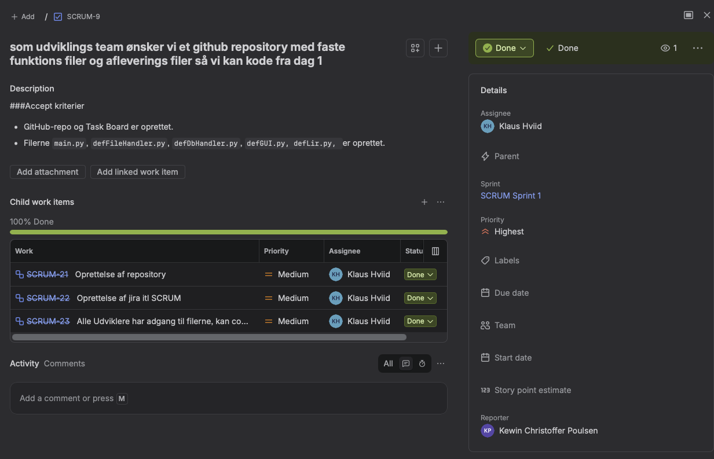

Den har dog fået nummer ni, men det er blot rækkefølgen de blev tastet ind i Jira efter vores Sprint Planning torsdag den 5/11/2026. Vi fyldte disse i vores backlog og lod som om, at de var fra "Product owner". Herefter gik sprint 1 af 1 i gang, hvor vi som gruppe havde en brainstorming session over alle de funktioner vi skulle bruge i programmet. Disse blev fyldt ind i et online tavle værktøj. Både hvordan vi skulle designe menuer og undermenuer og hvilke funktioner vi skulle bruge:
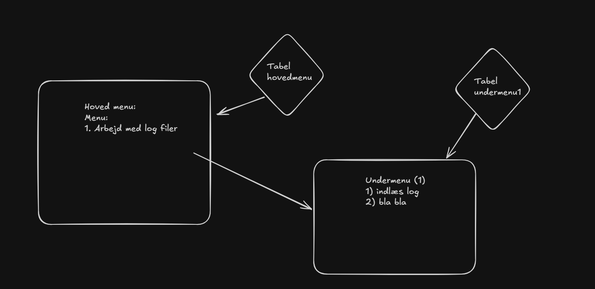

Dette førte til en funktionsliste - indledende (den voksede med opgaven og de blev også lavet som subtasks til jira tasks). 

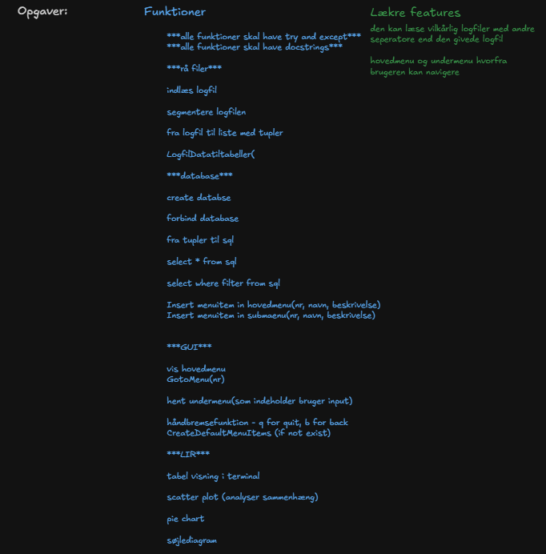

Vi oprettede også andre tasks på vores tasks oversigt i vores sprint der kun havde at gøre med udviklingsteamet og ikke product owners user stories.
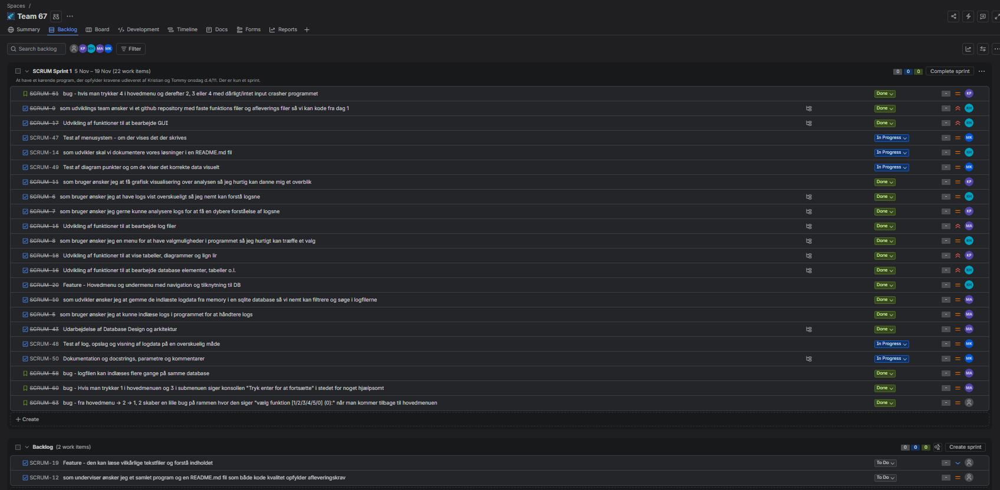

Jira har et taskboard, hvor vi i teamet kunne vælge og uddelegere de opgaver, hvor de stærkeste kompetencer var (Programmering, Scrum, Database design, Test osv.)
Følgende screenshot er taget ved projektets afslutning:

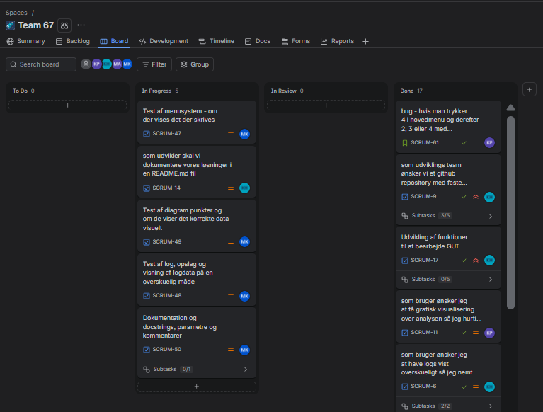

Det skal bemærkes, at da Test gik i gang, da blev der oprettet nye Scrum tasks, hvor typen blev angivet til BUG - dvs blev der fundet en fejl, mangel eller lignende, da blev den lagt i sprintets backlog og en af udviklerne tog opgaven til sig (hvis det var vedrørende menu systemet, da tog den person med den indsigt sig opgaven til sig)

### Tasks
Hver User Story er blevet opbrudt i konkrete, håndterbare **Tasks** (opgaver). Disse har repræsenteret de tekniske skridt, der skulle udføres af teammedlemmerne for at opfylde målet – såsom oprettelse af databasetabeller i `defDbHandler.py`, opsætning af diagramlogik i `defDiagramMaker.py` eller design af brugerfladen i `defGUI.py`.
Databasens design blev tegnet og vores ambitioner var, at lave en database med event typer, brugere, kendte ip'er, porte osv. På det vedhæftede billede, da er nogle tabeller angivet med [] i deres navn. Disse blev fra valgt, da vi ramte et punkt hvor vi tidsmæssigt ikke ville kunne komme i mål - samt det lå langt ude for opgaven.
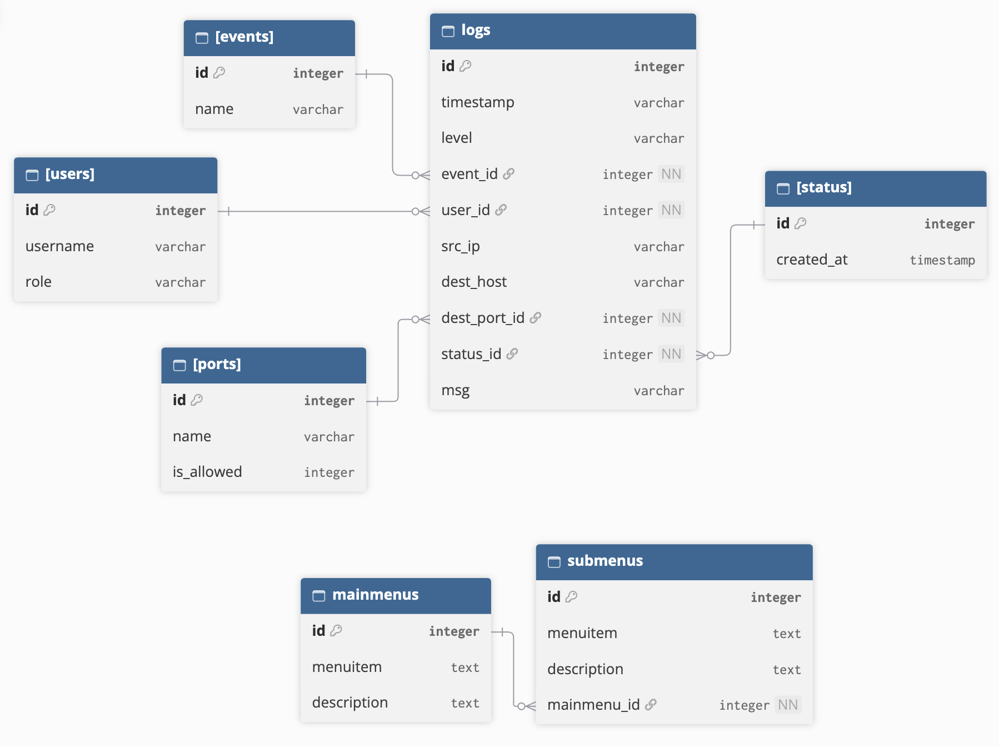

### Acceptkriterier
For hver User Story og tilhørende opgave blev der defineret præcise **Acceptkriterier**. Disse har fungeret som "definition of done", hvilket betyder, at en opgave først er blevet godkendt, når koden kørte fejlfrit, håndterede undtagelser (`exceptions`) og levede op til kravene i opgavebeskrivelsen.

### Task Board
Gruppen har anvendt et **Task Board** (Jira) undervejs i forløbet til at organisere, tildele og følge op på opgavernes status (*To Do*, *In Progress*, *Done*). Dette har sikret et fuldstændigt overblik over projektets fremdrift i det enkelte sprint.

Vores burndown chart ser således ud:

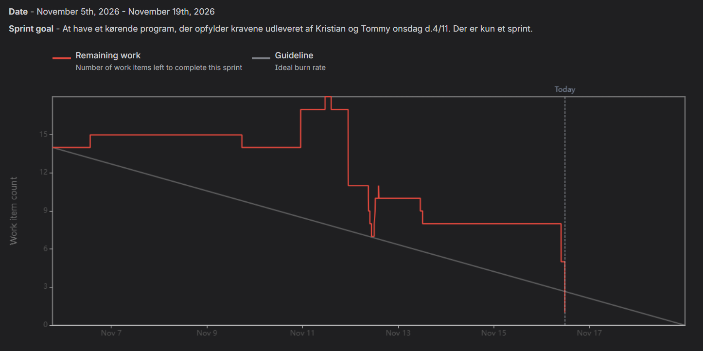
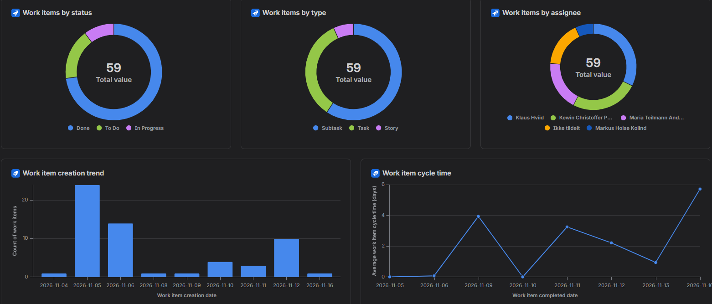

### Sammenhængen mellem elementerne
Sammenhængen i vores SCRUM-metodologi har været den røde tråd fra overordnet behov til færdig kode:
1. **User Stories** definerer *hvorfor* og *hvem*.
2. **Tasks** nedbryder opgaven i *hvad* der skal kodes.
3. **Acceptkriterier** definerer *hvornår* opgaven er godkendt.
4. **Task Board** holder styr på arbejdsgangen, indtil koden implementeres i de respektive moduler.

---

## 3. Brug af AI til opgaven

I den indledende fase fik vi AI til at skabe et statisk mock-up layout ved brug af Python's `rich`-package for hurtigt at visualisere, hvordan en avanceret DOS-lignende terminal brugerflade kunne se ud. 

Dette statisk genererede layout tog vi efterfølgende udgangspunkt i og modificerede koden omkring. For at gøre systemet professionelt, skalerbart og dynamisk valgte vi at omdesigne arkitekturen:
* Vi oprettede `defInit.py`, `defGUI.py` og `main.py`.
* Menupunkter og undermenuer hardcodes ikke længere, men blev i stedet lagret i vores SQLite-database (`bumlebusiness.db`) via `defDbHandler.py`.
* Vi benyttede **fremmednøgler (foreign keys)** og sammensatte primærnøgler i databasen til at styre hierarkiet mellem hovedmenu (`mainmenu`) og undermenu (`submenu`), hvilket gør det muligt dynamisk at generere skærmbilleder og menustrukturer direkte baseret på tabellernes indhold.

---

## 4. Konklusion og Analyse af logs

Det færdige projekt lever fuldt ud op til de opstillede krav for Bumle Business' VPN-log overvågning:
* Vi kan se, jvf vores tabelvisninger og diverse diagrammer, at systemet rammes af et brute-force angreb om morgenen og i løbet af dagen, da får forskellige brugere hacket deres konti, ændret deres password. Så hele systemet er overtaget af udefrakommende på sysadmin niveau.
* Først går vi ip-adresser igennem i vores program og finder følgende ip: 198.51.100.23 som vi finder interessant, da ip-adressen forsøger med mange brugernavne og både fejler og lykkedes med nogle, ændre password, placerer malware
  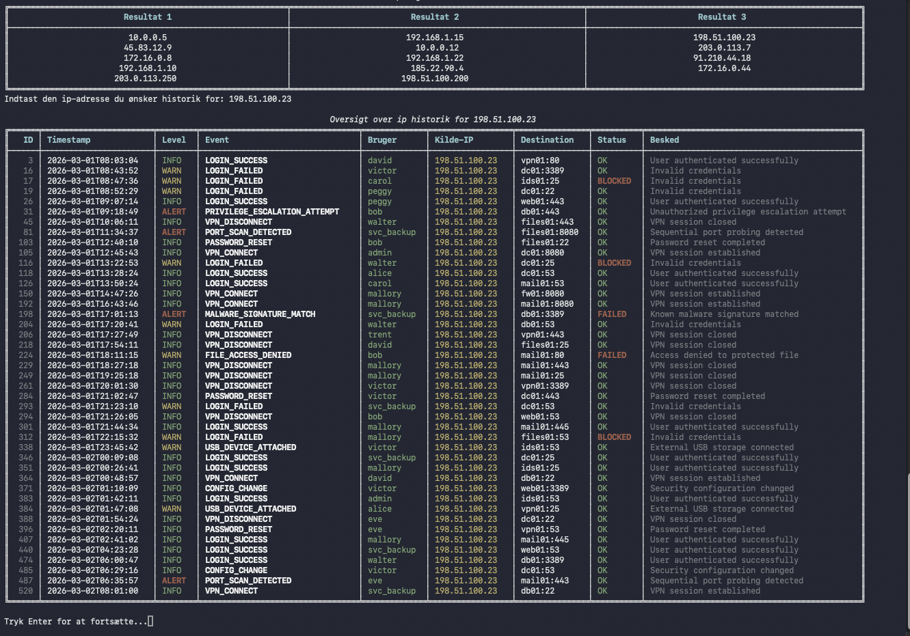
* Hvis vi herefter kigger på brugeren admin, da kan vi se, at administrator kontoen meget tidligt får nulstillet sin admin adgangskode og senere kan vi se, at en forsøger at logge på, eller eskalere sine rettigheder til admin. Hvilket nok er den rigtige administrator, der ikke længere kan komme ind med sin adgangskode. Dvs systemet er overtaget
  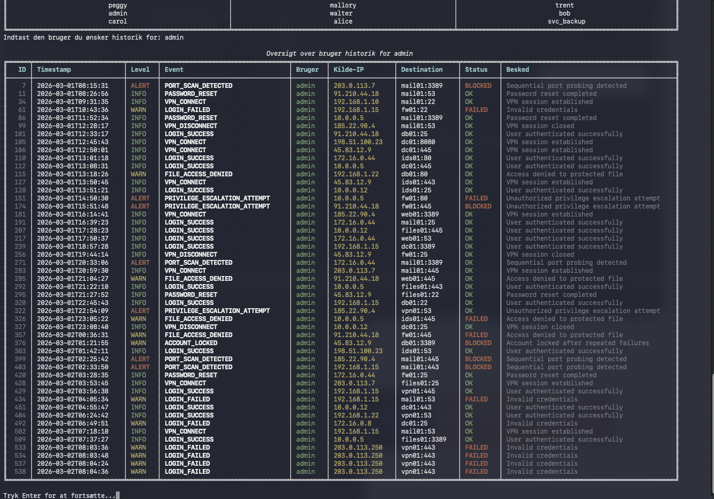
* Ip adressen, der ændrer admin adgangskoden er 91.210.44.18 - som vi også kan tage en historik på:
  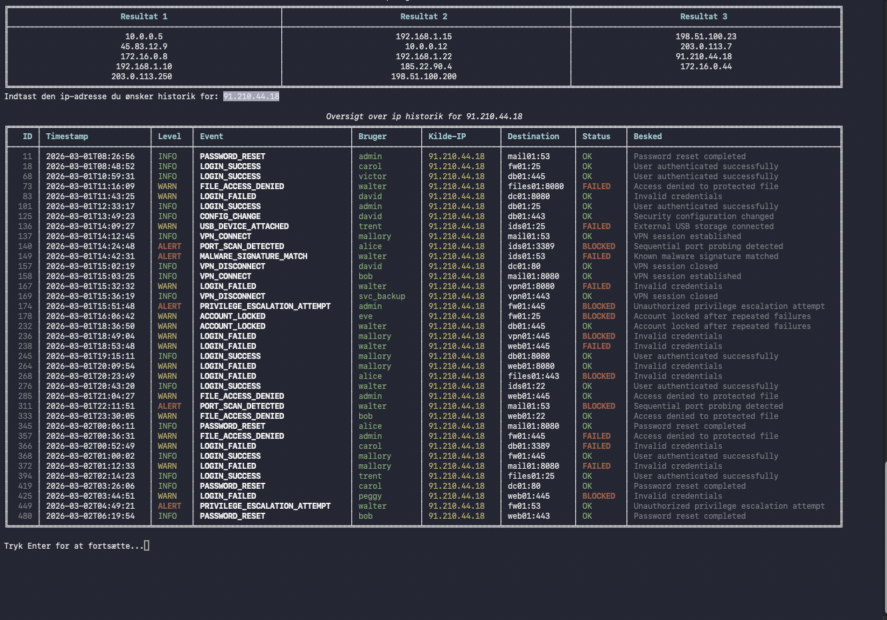
* Scatterplot på hvor mange forskellige brugere 198.51.100.23 er på som kan vises på et punktdiagram/scatterplot:
  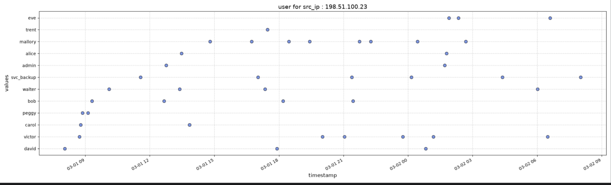
* Vi kan derfor konkludere, vha af vores program, at Bumle Business er offer for et bruteforce angreb fra minimim to ip-adresser, hvor det lykkedes at overtage hele systemet, ændre på sikkerhedsregler, placering af malware, adgang til filservere, postservere, id-servere oma.
  

* Modulær kodestruktur: Koden er opdelt i logiske moduler (`main.py`, `defInit.py`, `defDbHandler.py`, `defFileHandler.py`, `defGUI.py` og `defDiagramMaker.py`), hvilket sikrer høj genbrugbarhed og let vedligeholdelse.
* Robusthed: Der er implementeret fejlhåndtering (`try-except` blokke) og fejlhåndterings mekanismer ved indlæsning af filer og databaseoperationer.
* Visualisering og analyse: Systemet gør det muligt både at vise rå og strukturerede tabeller i konsollen samt generere dybdegående grafer (scatter-plots med/uden tendenslinjer, pie-charts og bar-charts) til analyse af sikkerhedshændelser

### Forbedringsmuligheder
* Vi har en feature i vores backlog, der omhandlede programmets mulighed for at akkumulere logdata, indlæsning af flere filer. Samt, som tidligere nævnt, havde vi et ønske om, at vi kunne konfigurere programmet med godkendte brugernavne, kendte servere/pc'er/godkendte porte, event-typer osv. Denne ambition lagde vi på hylden i sprint


---

## 5. Systemets Brugerflade (Screenshots)

Herunder ses eksempler på, hvordan programmet tager sig ud i terminalen under kørsel:

### Hovedmenu
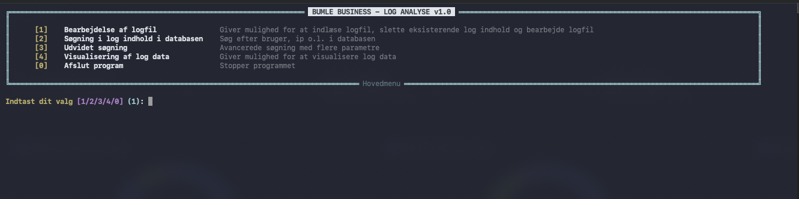

### Undermenuer
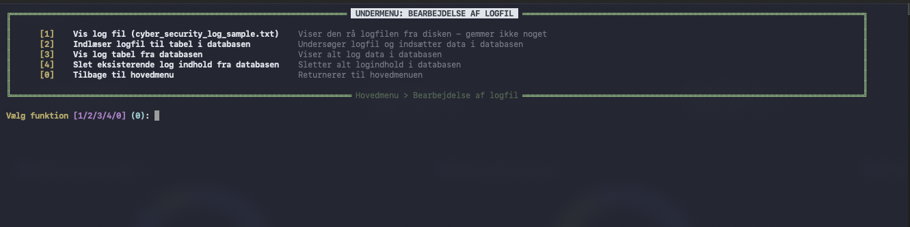
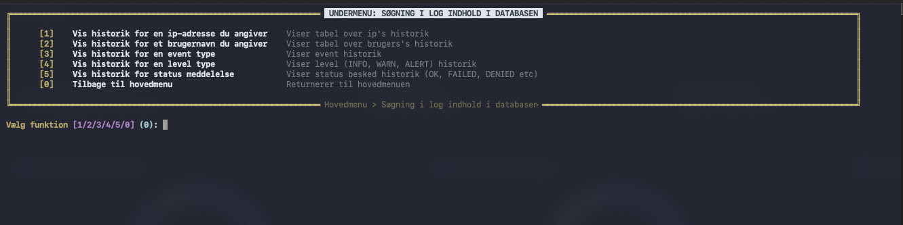
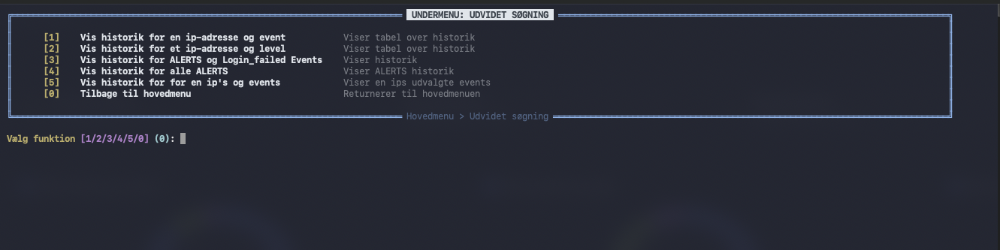
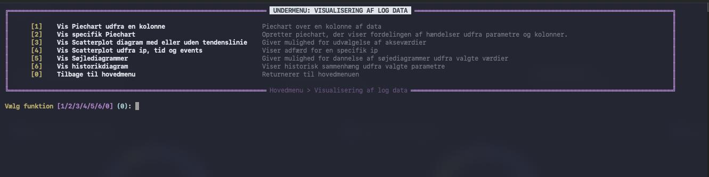

### Validering af logfil og fejl, hvis brugeren forsøger at indlæse den flere gange. Vi har mange andre valideringer, dette er en af dem:
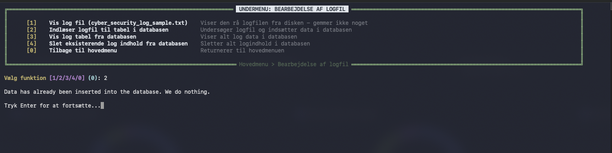

### Visning af log data i en overskuelig tabel:

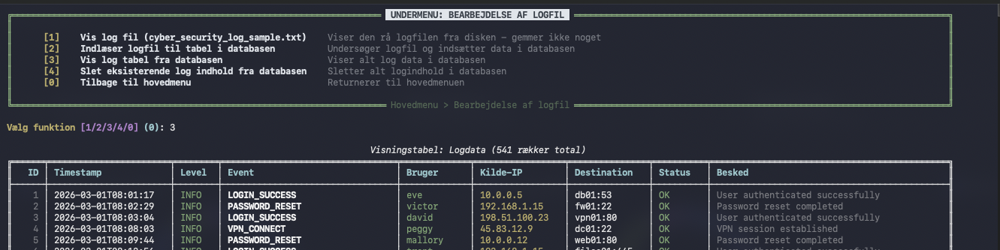

### Visning af diagrammer (piechart, scatterplots, barchart) - scatterplot screenshot:
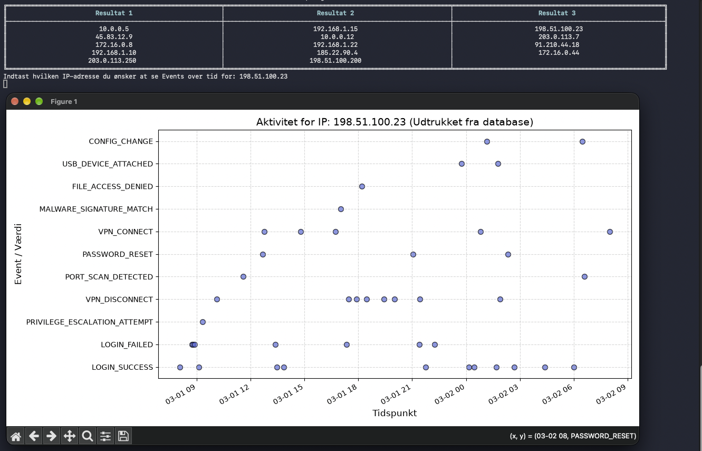
## Installation og Kørsel

For at installere alle nødvendige afhængigheder (som angivet i `requirements.txt`), kan du køre følgende kommando i din terminal:

```bash
pip install -r requirements.txt
```

Herefter startes programmet ved at køre hovedfilen:

```bash
python main.py
```